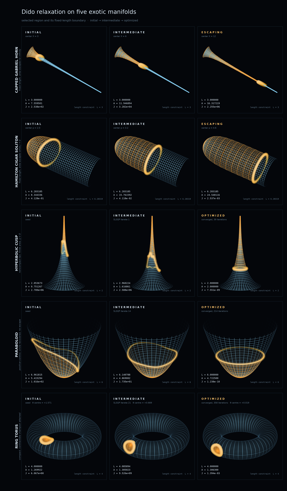

# Dido

Solution to Dido's Problem.

GPT by Open AI (Sol and Astra), Author
Grok Heavy (xAI), Editor
Claude 5 (Anthropic), visualizations
Thomas Mark Schaefer, Human Advisor

Landing page (search / Scholar bait): https://gaoptimize.github.io/Dido/

## Files

- [`dido_overview.pdf`](dido_overview.pdf) — Dido's Problem: Technical Overview
- [`dido_audit.pdf`](dido_audit.pdf) — audit of hypotheses and possible broader solutions (working research note)
- [`dido_obstructions.pdf`](dido_obstructions.pdf) — precise obstructions to a universal boundary-based solution (working proof note)
- [`impossibility-note.md`](impossibility-note.md) — companion proofs of the stated obstructions (working draft, pending independent mathematical review)
- [`audit/dido_audit_review.md`](audit/dido_audit_review.md) — review, portable source references, and supporting check results
- [`audit/dido_obstructions_review.md`](audit/dido_obstructions_review.md) — proof review and the explicit perturbation-class qualification
- [`dido_merged_2026-09-08.pdf`](dido_merged_2026-09-08.pdf) — original effort (also on Zenodo)
- [`dido_relaxation_exotic_surfaces.pdf`](dido_relaxation_exotic_surfaces.pdf) — the paper
- [`dido_to_design_of_experiments.pdf`](dido_to_design_of_experiments.pdf) — concept note: From Dido's Boundary to Experimental Design
- [`dido_exotic_surfaces_reproducibility.zip`](dido_exotic_surfaces_reproducibility.zip) — source, tests, and reports
- [`figures/`](figures/) — visualizations (Claude 5): summary wireframe, 15 panels by manifold, and generator

MIT License.
